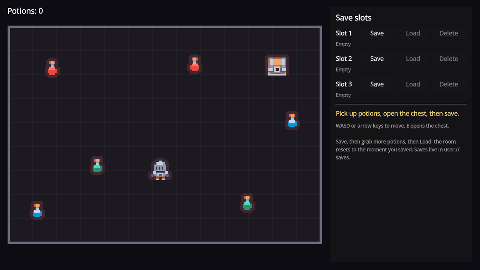
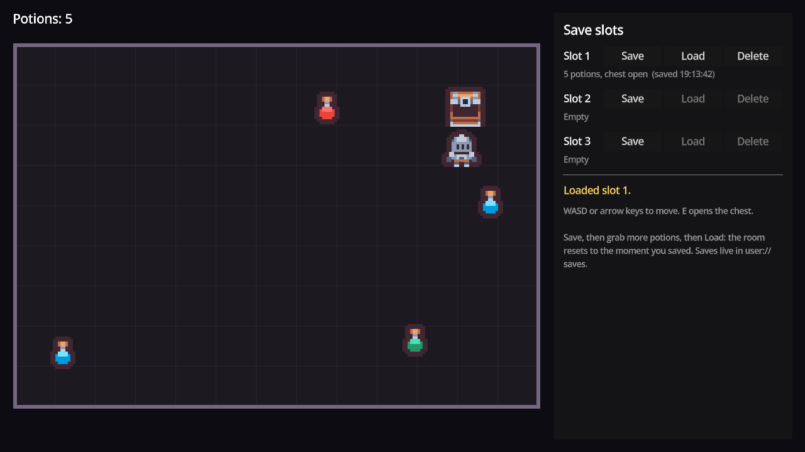

# Godot Save System

A slot-based save and load system for Godot 4 with persistent world objects:
picked-up items stay picked up, opened chests stay open, and the player comes back
exactly where they saved.



## Features

- **Save slots** with a folder per slot: `state.json` for the game data and
  `meta.json` for what a save menu lists (time saved, a summary line, version).
- **Atomic writes.** Each file is written to a `.tmp` file first and then renamed,
  so a crash mid-save cannot corrupt a slot.
- **The `persist` group pattern.** Any node in the `persist` group with
  `save_to_state(state)` and `load_from_state(state)` is saved and loaded for you.
  No central list of what to save.
- **Removed objects.** Call `SaveManager.mark_removed(self)` before freeing a
  collected item or a killed enemy and it stays gone after loading.
- **Load mid-game, correctly.** `reload_and_load_current_slot()` reloads the scene
  first, so an item you picked up after saving comes back.
- **Versioned saves** with a `_migrate()` hook for upgrading old save files after
  you change the format.
- **Errors you can handle:** `save_slot()` returns an `Error`, `load_slot()`
  returns `{ok, err, state}`, and `save_failed` and `load_failed` signals fire on
  any failure, including a corrupt file.
- **Slot helpers:** `has_save()`, `get_slot_info()`, `list_slots()` (newest first)
  and `delete_slot()`.
- **`SaveUtils`** for the types JSON cannot hold: `Vector2` and `Vector3` to and
  from dictionaries.

## Demo



A small room with six potions, a chest and three save slots. Walk over potions to
collect them and press **E** at the chest to open it. Save to a slot, collect more,
then load it: the room goes back to how it was when you saved.

## Requirements

- Godot **4.7** or later, standard build (GDScript only, no .NET needed).
- Tested on **Godot 4.7.2 stable** on Windows. Earlier 4.x versions are untested.
  `reload_and_load_current_slot()` uses `SceneTree.scene_changed`, which needs
  Godot 4.5 or later.
- Uses the Compatibility renderer, so it runs on older GPUs too.

## Installation

Clone the repository:

```bash
git clone https://github.com/CodingQuests/godot-save-system.git
```

Or download it with **Code > Download ZIP** and unzip it.

Then open Godot, click **Import**, pick the `project.godot` file inside the folder,
and click **Import & Edit**.

## Quick Start

1. Press **F5**.
2. Move with **WASD** or the arrow keys and collect a couple of potions.
3. Press **E** next to the chest to open it.
4. Click **Save** on Slot 1.
5. Collect more potions, then click **Load** on Slot 1.

Saves are written to `user://saves`. In the editor, **Project > Open User Data
Folder** shows you the JSON.

## How It Works

### Persistent nodes save themselves

`SaveManager` does not know what your game contains. When you save, it asks every
node in the `persist` group to write itself into one dictionary:

```gdscript
func _capture_state() -> Dictionary:
	var state: Dictionary = {}

	for node in get_tree().get_nodes_in_group("persist"):
		if node != null and node.has_method("save_to_state"):
			node.call("save_to_state", state)
```

The demo player looks like this:

```gdscript
func save_to_state(state: Dictionary) -> void:
	state["player"] = {
		"position": SaveUtils.vec2_to_dict(global_position),
		"potions": potions,
	}
```

When you load, each node reads its own key back in `load_from_state()`. A node
that can appear more than once, like the chest, uses
`SaveManager.persist_id(self)` (its scene path) as its key, so every chest keeps
its own state.

### What a slot looks like on disk

```
user://saves/slot_0001/state.json   {"version": 1, "saved_unix": ..., "data": {...}}
user://saves/slot_0001/meta.json    {"slot_id": 1, "updated_unix": ..., "summary": "..."}
```

`meta.json` is small on purpose, so a load menu can list every slot without
reading every save.

### Removed objects

A collected potion cannot save itself, because it no longer exists. So before it
frees itself it tells the save system:

```gdscript
SaveManager.mark_removed(self)
queue_free()
```

The list of removed ids is saved with the slot. On load, any node in the
`persist` group whose id is on that list is freed.

### Loading mid-game

Loading into the scene that is already running cannot bring back a potion you
picked up after saving: that node is gone. `reload_and_load_current_slot()`
reloads the scene first and applies the save when `SceneTree.scene_changed`
fires, so everything starts from the scene's original state and the save takes
it from there.

## Project Structure

```
project.godot                   Project file, SaveManager autoload, input actions
save_system/SaveManager.gd      The save system (an autoload)
save_system/SaveUtils.gd        Vector2 and Vector3 to and from JSON-safe dictionaries
demo/Main.tscn                  The demo room
demo/main.gd                    Demo only: draws the room, builds the slot buttons
demo/player.gd                  A persistent player: position and potion count
demo/potion.gd                  A collectible that uses mark_removed()
demo/chest.gd                   A chest that saves its own opened flag
assets/kenney_tiny-dungeon/     Kenney Tiny Dungeon tiles (CC0) and their license
```

## Using It In Your Own Game

1. Copy the `save_system/` folder into your project.
2. Add `save_system/SaveManager.gd` as an autoload named `SaveManager`
   (Project > Project Settings > Globals).
3. For each thing that should be saved, add it to the `persist` group and give
   it two methods:

   ```gdscript
   func _ready() -> void:
   	add_to_group("persist")


   func save_to_state(state: Dictionary) -> void:
   	state["player"] = {"hp": hp, "position": SaveUtils.vec2_to_dict(global_position)}


   func load_from_state(state: Dictionary) -> void:
   	var data: Dictionary = state.get("player", {})
   	hp = int(data.get("hp", hp))
   	global_position = SaveUtils.dict_to_vec2(data.get("position", {}))
   ```

4. Save and load:

   ```gdscript
   SaveManager.current_slot_id = 1
   SaveManager.save_current_slot("Forest, level 4")   # returns an Error
   SaveManager.reload_and_load_current_slot()         # mid-game load
   SaveManager.load_current_slot()                    # load into the scene as it is
   ```

Only store JSON-friendly values: numbers, strings, bools, arrays and dictionaries.
Convert vectors with `SaveUtils`, and store resources by their path.

## Customizing It

- **Where saves go:** `SAVES_DIR` at the top of `SaveManager.gd`.
- **Changing your save format:** bump `SAVE_VERSION`, then upgrade old data in
  `_migrate()`. The commented example shows the shape.
- **Save menu text:** pass a summary to `save_current_slot("...")`, or add more
  fields to `meta` in `save_slot()` (play time, a level name).
- **Autosave:** call `save_current_slot()` from a checkpoint, a timer, or
  `NOTIFICATION_WM_CLOSE_REQUEST`.

## Known Limitations

- Persistent ids are scene paths. Give persistent nodes unique names and keep them
  under the same parent, or their saved state will not find them.
- Nodes spawned at runtime (dropped loot, spawned enemies) are not recreated on
  load. Save them as data in a parent node's `save_to_state()` and respawn them
  in `load_from_state()`.
- `removed_nodes` lives in the autoload. Clear it (`SaveManager.removed_nodes.clear()`)
  when the player starts a new game.
- Saves are plain JSON, so players can read and edit them. Encrypt or sign them if
  that matters for your game.
- One scene at a time: the save covers whatever is in the current scene tree.
- Tested on Godot 4.7.2 on Windows only.

## License

MIT for the code. See [LICENSE](LICENSE).

## Third-Party Assets

The knight, chest and potion sprites are from
[Tiny Dungeon](https://kenney.nl/assets/tiny-dungeon) by Kenney, released under
CC0 1.0. Details in [THIRD_PARTY_ASSETS.md](THIRD_PARTY_ASSETS.md), and the pack's
original license is in `assets/kenney_tiny-dungeon/License.txt`.

## Learn How It Works

Want to understand how this works instead of just copying it?

CodingQuests teaches you how to build systems like this step by step in Godot,
with interactive lessons and real projects.

- **[Save + Load System](https://codingquests.io/quests/save-load-system?utm_source=github&utm_medium=resource&utm_campaign=godot_save_system)**
  builds this save system lesson by lesson: slots, atomic writes, the persist
  group pattern and versioning. The first 4 lessons are free.

Made by [CodingQuests](https://codingquests.io/?utm_source=github&utm_medium=resource&utm_campaign=godot_save_system).
